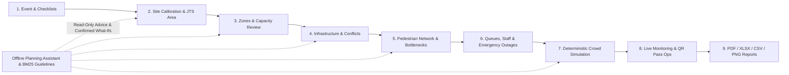

<div align="center">

# Vyuha

### Crowd Safety, Venue Planning & Stampede Prevention Platform

[](https://openjdk.org/projects/jdk/21/)
[](https://spring.io/projects/spring-boot)
[](#tech-stack)
[](#tech-stack)
[](#quick-start)
[](#optional-external-planning-assistant)

A self-contained, Java-first decision-support web platform for event organizers, safety reviewers, and field operations teams. Vyuha unifies spatial venue calibration, multi-constraint capacity planning, bottleneck screening, deterministic crowd simulation, live QR pass monitoring, an offline BM25 planning assistant, and structured reporting with **zero external CDNs** and **zero external database setup**.

</div>

> [!IMPORTANT]
> **Decision-Support Notice:** Vyuha highlights measurable layout risks and simulates relative layout comparisons. All capacity limits, formal safety approvals, and real-world emergency command decisions remain strictly human-led.

---

## Contents

- [Platform Workflow](#platform-workflow)
- [Core Capabilities](#core-capabilities)
- [Tech Stack](#tech-stack)
- [Quick Start](#quick-start)
- [Optional External Planning Assistant](#optional-external-planning-assistant)
- [Seeded Demo Accounts](#seeded-demo-accounts)
- [Flagship Walkthrough: "TechnoVyuha Annual Campus Festival"](#flagship-walkthrough-technovyuha-annual-campus-festival)
- [Project Structure](#project-structure)

---

## Platform Workflow



---

## Core Capabilities

### 1. Governance, RBAC & Event Setup
- **4-Role Spring Security Access Control:** Enforces separation of duties across `ADMIN`, `ORGANIZER`, `SAFETY_REVIEWER`, and `FIELD_STAFF`.
- **Category-Tailored Safety Checklists:** Generates event-specific checklist items on creation and tracks completion progress.
- **Formal Safety Reviews & Supporting Docs:** Maintains reviewer sign-off records and multipart document attachments (`10 MB` max file / `12 MB` max request).

### 2. Site Plan Calibration & Usable Area Engine
- **Two Workspace Modes:** Upload an orthographic site blueprint (`BLUEPRINT_UPLOAD`) or load one of 3 built-in GeoJSON sample maps (`campus-quadrangle.geojson`, `civic-plaza.geojson`, `stadium-ground.geojson`) in `INTERACTIVE_MAP` mode.
- **Pixel-to-Meter Calibration:** Verifies spatial scale factors with mismatch reporting before any area calculations run.
- **JTS Usable Area Deduction:** Computes gross perimeter and deducts union-deduplicated exclusion polygons (`BUILDING`, `STAGE`, `EQUIPMENT`, `RESTRICTED`, `FACILITY`, `RESERVED_WALKWAY`) via JTS `1.19.0`.

### 3. Grid, Functional Zones & Multi-Constraint Capacity
- **Clipped Spatial Grid:** Generates pure-Java JTS-clipped grids (`2 m`–`20 m` cell sizes) with configurable origin and rotation, supporting cell-union zone authoring.
- **11 Standardized Zone Types & Validation:** Automatically detects unassigned space, overlaps (`> 0.1 m²`), out-of-bounds geometry, and cut-off/isolated walkable zones (`> 1.0 m` adjacency check).
- **Multi-Constraint Capacity Model:** Calculates $C_{\text{space}}$, $C_{\text{flow}}$, $C_{\text{holding}}$, and $C_{\text{official}}$, highlighting the tightest governing constraint for formal reviewer sign-off.

### 4. Infrastructure Canvas & Spatial Conflict Engine
- **HTML5 `<canvas>` Placement Workspace:** Offline vanilla ES6 `<canvas>` editor with Undo/Redo command history and persisted layout revisions.
- **12 Catalog Infrastructure Types:** Supports stages, stalls, barricades, gates, security checkpoints, medical posts, emergency lanes, and support assets with default physical dimensions and throughput rates.
- **Automated Conflict Detection:** Flags spatial overlaps, obstructed corridors, emergency lane encroachments, and clearance violations.

### 5. Pedestrian Movement Network & Bottleneck Screening
- **Layered Directed/Bidirectional Graph:** Models `NORMAL_ENTRY`, `INTERNAL_CIRCULATION`, `NORMAL_EXIT`, and `EMERGENCY_ACCESS` layers across 7 node types (`ENTRY_GATE`, `EXIT_GATE`, `EMERGENCY_EXIT`, `SECURITY_CHECKPOINT`, `ZONE_HUB`, `INTERSECTION`, `SERVICE_POINT`).
- **8 Deterministic Bottleneck Detectors:** Screens for `DISCONNECTED_ZONE`, `ISOLATED_EXIT`, `DEAD_END_CORRIDOR`, `NARROW_WALKWAY`, `HIGH_CONVERGENCE_MERGE`, `CONTRA_FLOW_CONFLICT`, `CROSSING_QUEUE_CONFLICT`, and `ENTRY_GATE_OVERLOAD`.

### 6. Arrival Waves, Queue Projections & Staff Coverage
- **Interval Queue Modeling:** Projects queue buildup across arrival windows using $Q_t = \max(0, Q_{t-1} + \text{Arrivals}_t - \text{GateCapacity}_t)$, estimating peak wait times, multi-gate parallel slot splits, and holding-area overflow ($\text{m}^2$ deficit).
- **Staff Coverage & Shift Auditing:** Checks staffing targets across `SECURITY`, `VOLUNTEER`, `MEDICAL`, and `SUPERVISOR` roles, using sweep-line timeline checks to detect coverage gaps and double-booked overlapping shifts.
- **Incident Logging:** Tracks operational incidents across `OPEN`, `IN_PROGRESS`, `ESCALATED`, and `RESOLVED` statuses.

### 7. Emergency Preparedness & Failure-Mode Testing
- **Emergency Route Validation:** Enforces $\ge 3.50\text{ m}$ clear width and obstacle-free geometry across `EMERGENCY_EXIT`, `ASSEMBLY_POINT`, `AMBULANCE_ROUTE`, and `FIRE_ROUTE` assets plus emergency access corridors.
- **Interactive Outage Testing:** Simulates closing specific exits or blocking corridors via `MovementGraphService`, reporting `UNAFFECTED`, `REROUTED`, `NEWLY_ISOLATED`, and `ALREADY_ISOLATED` zones, shortest backup routes, detour distances, narrowest backup widths, and egress throughput loss `%`.
- **Prioritized Emergency Contacts:** Maintains ordered agency escalation directories per event.

### 8. Deterministic Crowd Simulation & Before-and-After Comparison
- **Pure-Java Agent-Based Engine:** Simulates movement across JTS obstacle-adjusted corridor widths with Weidmann speed-density slowdown, gate/checkpoint/corridor queues, congestion-weighted Dijkstra rerouting, and reproducible `Random(seed)` playback frames.
- **5 Built-In Scenarios:** `NORMAL_OPERATIONS`, `ARRIVAL_RUSH`, `STAGE_CROWDING`, `BLOCKED_CORRIDOR`, and `CLOSED_EXIT`.
- **Before-and-After Layout Comparison:** Persists immutable layout snapshots and verifies parameter parity to compare KPI deltas side by side (e.g., Layout V1 vs. Layout V2).

### 9. Live Event Monitoring & Field Operations
- **Strict Zero-Blending Channel Isolation:** Tracks `MANUAL_STAFF`, `PASS_SCAN`, and `PRACTICE_SIMULATION` occupancy streams independently without blending telemetry.
- **Real-Time SSE Control Centre:** Pushes live zone load updates (`NO_DATA`, `STALE`, `LOW_LOAD`, `MODERATE_LOAD`, `HIGH_LOAD`, `CRITICAL_LOAD`, `UNRATED`) and alert diffs (`CAPACITY_WARNING`, `CAPACITY_CRITICAL`, `STALE_DATA`, `DUPLICATE_PASS_SCAN`) over Server-Sent Events.
- **ZXing QR Pass Operations & Mobile `/field` View:** Generates and decodes unique `VYU-XXXX-XXXX` QR passes (`ISSUED` / `CHECKED_IN` / `CHECKED_OUT`) alongside manual headcounts and field incident updates.

### 10. Built-In Planning Assistant & Safety Guidelines
- **100% Offline Default (`VYUHA_LOCAL_JAVA`):** Explains verified area, capacity, spatial conflict, bottleneck, and simulation findings in plain language with mandatory `"AI/Assistant Note — Human Review Required"` attribution.
- **Okapi BM25 Guideline Search:** Indexes 4 local JSON safety corpora (including NDMA crowd management guidelines, egress/corridor design, queue/arrival wave management, and emergency access/live ops) returning ranked excerpts with document title, section number, authority, year, and verbatim quote.
- **Confirmation-Gated What-If Previews:** Parses natural-language What-If prompts into `SimulationConfig` parameters and requires explicit user confirmation before executing a simulation run.

### 11. Structured Reporting & Exports
- **4 Export Formats with Audit Trail:**
  - **PDF Report:** A4 printable safety report generated via OpenHTMLToPDF with embedded high-resolution Java2D PNG layout and Before/After comparison maps.
  - **Excel Workbook (`.xlsx`):** 12-sheet structured workbook built with Apache POI.
  - **CSV Datasets:** 5 selectable RFC-4180 CSV exports.
  - **PNG Snapshots:** High-resolution rendered venue layout and comparison graphics.
- **Readiness Gate & Audit Log:** Evaluates section completeness across event modules and logs every export in `report_exports`.

---

## Tech Stack

| Layer | Technology | Version / Details |
|---|---|---|
| **Language & Runtime** | Java | `JDK 21 (LTS)` |
| **Framework** | Spring Boot (Web, Security, Data JPA, Validation, Thymeleaf) | `3.3.5` |
| **Database & Migrations** | H2 (file-mode `./data/vyuha-db`) + Flyway Core | Migrations `V1`–`V12` |
| **Spatial Geometry** | LocationTech JTS (`jts-core`) | `1.19.0` |
| **QR Codes** | Google ZXing (`core` & `javase`) | `3.5.3` |
| **PDF Generation** | OpenHTMLToPDF (`openhtmltopdf-pdfbox`) | `1.0.10` |
| **Excel Generation** | Apache POI (`poi-ooxml`) | `5.2.5` |
| **Frontend** | Vanilla ES6 JavaScript, HTML5 `<canvas>`, local CSS tokens | `Zero external CDNs` |

---

## Quick Start

### Prerequisites
- **Java Development Kit (JDK) 21** (`java -version`)

### 1. Clone & Verify Tests

> [!NOTE]
> The repository includes the Windows Maven Wrapper (`mvnw.cmd`). On macOS/Linux, run the same goals with a local Maven installation (`mvn`).

```powershell
git clone https://github.com/Sujalkan07/Vyuha.git
cd Vyuha
.\mvnw.cmd clean test
```

### 2. Run the Application

```powershell
.\mvnw.cmd spring-boot:run
```

On startup, Flyway automatically creates `./data/vyuha-db` and applies migrations `V1`–`V12`. Open **[http://localhost:8080](http://localhost:8080)** in your browser.

> [!TIP]
> **Local Data Privacy:** The `./data/` directory (H2 database files and uploaded documents/simulation frames) is listed in [`.gitignore`](.gitignore). Any events or drafts you create locally stay strictly on your machine and are never committed to Git.

---

## Optional External Planning Assistant

By default, Vyuha runs **100% offline** using `LocalDeterministicAssistantProvider`. To optionally connect an external OpenAI-compatible endpoint, set the following environment variables (defined in [`application.yml`](src/main/resources/application.yml)):

| Variable | Default | Description |
|---|---|---|
| `VYUHA_ASSISTANT_PROVIDER` | `local` | Set to `openai` to enable the external provider; falls back safely to `local` |
| `VYUHA_ASSISTANT_ENDPOINT` | *(empty)* | OpenAI-compatible chat completions endpoint URL |
| `VYUHA_ASSISTANT_API_KEY` | *(empty)* | API key for the external provider |
| `VYUHA_ASSISTANT_MODEL` | *(empty)* | Model identifier passed to the external endpoint |
| `VYUHA_ASSISTANT_TIMEOUT_MS` | `8000` | Request timeout in milliseconds |

---

## Seeded Demo Accounts

V1 migration seeds 4 ready-to-use accounts across every RBAC role:

| Role | Email | Password | Primary Workspace |
|---|---|---|---|
| `ADMIN` | `admin@vyuha.local` | `VyuhaAdmin123!` | Full access + `/admin/users` + Demo Reset |
| `ORGANIZER` | `organizer@vyuha.local` | `VyuhaOrg123!` | Event planning, canvas editors, simulation, reports + Demo Reset |
| `SAFETY_REVIEWER` | `reviewer@vyuha.local` | `VyuhaRev123!` | Read access, formal safety reviews, checklist sign-off, capacity verification, simulation, reports |
| `FIELD_STAFF` | `staff@vyuha.local` | `VyuhaStaff123!` | Mobile-friendly `/field` workspace (shifts, manual counts, QR pass scanning, incident logs) |

---

## Flagship Walkthrough: "TechnoVyuha Annual Campus Festival"

On first startup, Vyuha automatically seeds **"TechnoVyuha Annual Campus Festival"** (`3,500` expected attendance, `COLLEGE_FESTIVAL`). `ADMIN` and `ORGANIZER` users can restore it to a clean baseline anytime via **Reset Campus Festival Demo** on the Events Dashboard or **Reset Demo Event** on the Reports tab (`POST /events/demo-reset`):

1. **Overview Tab (`/events/{id}`):** Inspect category-tailored Campus Festival checklist progress, formal safety review logs between `Dr. Kavita Rao` and `Aarav Mehta`, and reviewer sign-offs.
2. **Venue Plan -> Site Plan (`/events/{id}/venue?mode=site`):** Inspect the calibrated `120 m x 90 m` orthographic campus quadrangle blueprint (`10.0 px/m`, `0.0%` scale verification mismatch), outer perimeter (`7,488 m²` gross), and JTS union-deduplicated exclusions.
3. **Venue Plan -> Zones, Infrastructure & Pathways:** Explore the functional zones, physical infrastructure elements, and pedestrian network. Review how Layout V1's hazards (Food Stall #3 intruding into the East Ambulance Lane, narrow `1.8 m` central pinch corridor, crossing North gate entry/exit flow, and obstructed South-West exit barricade) are remediated in Layout V2 (`4.5 m` central promenade, relocated stall, dedicated North-East Exit Gate, cleared exit apron).
4. **Capacity & Staff (`/events/{id}/capacity`):** Review multi-constraint capacity ceilings (`C_space`, `C_flow`, `C_holding`, `C_official`), arrival wave queue projections (`16:00`–`20:00`), staff shift coverage across 6 personnel, and logged incidents.
5. **Emergency (`/events/{id}/emergency`):** Test interactive exit/corridor outage simulations and inspect `>= 3.50 m` ambulance/fire route validation plus prioritized emergency contacts.
6. **Simulation (`/events/{id}/simulation`):** Switch to **Before-and-After Comparison** to compare **Snapshot V1 (Flawed)** vs. **Snapshot V2 (Remediated)** under the identical `ARRIVAL_RUSH` scenario (seed `2026`), observing reduced peak local density and faster clearance.
7. **Live Ops (`/events/{id}/live`) & Field View (`/field`):** Switch independently between `MANUAL_STAFF` and `PASS_SCAN` channels (plus `PRACTICE_SIMULATION`), inspect the 12-pass QR batch, and verify zero telemetry blending.
8. **Planning Assistant Drawer & Guidelines (`/guidelines`):** Click **Planning Assistant** in the workspace footer to inspect plain-language explanations, preview/run `What-If` simulations with explicit confirmation, and search offline safety guidelines with BM25 citations.
9. **Reports (`/events/{id}/reports`):** Check section readiness and download the printable A4 **PDF Report**, 12-sheet **Excel Workbook (`.xlsx`)**, modular **CSV** datasets, and high-resolution **PNG** layout & Before-and-After comparison snapshots.

---

## Project Structure

```text
Vyuha/
├── pom.xml                                  # Spring Boot 3.3.5, Java 21, JTS, ZXing, OpenHTMLToPDF, POI
├── mvnw.cmd                                 # Windows Maven wrapper
└── src/
    ├── main/
    │   ├── java/com/vyuha/                  # 199 Java source files across 15 domain packages
    │   │   ├── VyuhaApplication.java
    │   │   ├── assistant/                   # Offline advisor, NL What-If parser, BM25 guideline search
    │   │   ├── auth/                        # RBAC roles, users, login & admin user management
    │   │   ├── capacity/                    # Multi-constraint capacity calculator & density reviews
    │   │   ├── common/                      # JTS GeometryUtil, audit fields, global error handling
    │   │   ├── config/                      # Security, WebMvc, multipart/upload storage config
    │   │   ├── emergency/                   # >=3.50m route validation, outage testing, contacts
    │   │   ├── event/                       # Event lifecycle, tailored checklists, safety reviews
    │   │   ├── grid/                        # JTS clipped grid generator & zone validation
    │   │   ├── infrastructure/              # 12-type asset catalog, Undo/Redo, spatial conflicts
    │   │   ├── monitoring/                  # SSE hub, ZXing QR passes, channel-isolated alerts
    │   │   ├── network/                     # Pedestrian graph & 8 deterministic bottleneck checks
    │   │   ├── operations/                  # Queue projections, staff shift coverage, field ops
    │   │   ├── reporting/                   # PDF/XLSX/CSV/PNG exports & Campus Festival demo seed
    │   │   ├── simulation/                  # Deterministic crowd simulation & V1/V2 comparison
    │   │   └── venue/                       # Site blueprint calibration & JTS usable-area engine
    │   └── resources/
    │       ├── application.yml              # File-mode H2, Flyway, upload & assistant config
    │       ├── db/migration/                # Flyway SQL migrations V1__init_auth.sql .. V12__report_exports.sql
    │       ├── guidelines/                  # 4 offline JSON safety guideline corpora
    │       ├── sample-maps/                 # 3 built-in GeoJSON sample venue maps
    │       ├── static/                      # Local CSS tokens/stylesheets & ES6 canvas/API modules
    │       └── templates/                   # Server-rendered Thymeleaf views & workspace fragments
    └── test/                                # 36 unit, integration & E2E test classes (113 tests)
```
